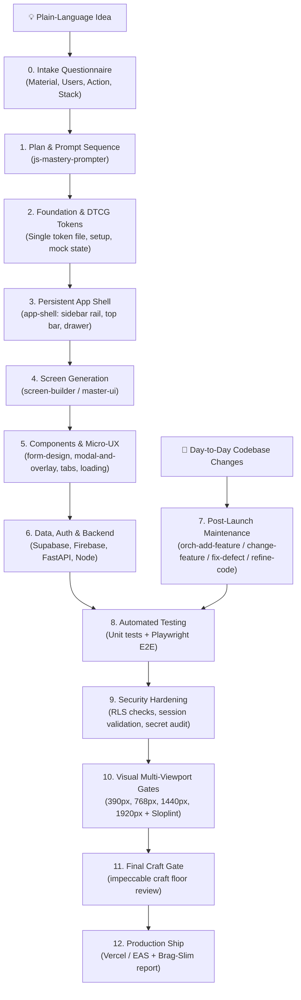

# 🚀 Vibe Coding Master Ecosystem

> **The definitive agentic operating system for building, iterating, and shipping production-grade applications and landing pages from plain-language ideas.**

[](LICENSE)
[](#-required-mcp-configuration)
[](#-installation--setup)

---

## 📖 Overview

The **Vibe Coding Master Ecosystem** orchestrates specialized AI coding skills into a coherent, gated 12-stage engineering pipeline. Instead of relying on monolithic, one-shot code generation that degrades into generic templates, this system enforces:

1. **Strict Ownership Boundaries**: Each architectural concern (planning, foundations, shells, screens, micro-UX, and reviews) is governed by exactly one specialist skill.
2. **Surface Separation**: Landing pages and showcases run through narrative-driven visual engineering ([`master-ui`](skills/master-ui/SKILL.md)), while dashboards, settings, and forms run through state-complete application engineering ([`screen-builder`](skills/screen-builder/SKILL.md)).
3. **Single DTCG Token Governance**: Every build establishes a single Design Tokens Community Group (W3C DTCG) token specification. No hardcoded hex codes or arbitrary CSS utilities.
4. **Mechanical Quality Gates**: Automated visual verification, multi-viewport inspection (390px, 768px, 1440px, 1920px), blocking Sloplint checks, and final craft floor evaluation by [`impeccable`](skills/impeccable/SKILL.md).

---

## 🔄 The 12-Stage Lifecycle



---

## 🧭 Master Routing Matrix

| Request Signal | Execution Route | Responsible Owner |
| :--- | :--- | :--- |
| **New App from Scratch** | Stages 1 through 6, then Stages 8 through 12 | [`vibe-coding-master`](skills/vibe-coding-master/SKILL.md) $\rightarrow$ [`js-mastery-prompter`](skills/js-mastery-prompter/SKILL.md) |
| **Landing Page / Showcase** | [`master-ui`](skills/master-ui/SKILL.md) (Persuade mode), then Stages 8, 10, 11 | [`master-ui`](skills/master-ui/SKILL.md) |
| **App Screen (Dashboard / Settings / Login / Form)** | [`screen-builder`](skills/screen-builder/SKILL.md), then Stages 8, 10 | [`screen-builder`](skills/screen-builder/SKILL.md) |
| **Persistent Navigation Shell** | [`app-shell`](skills/app-shell/SKILL.md) (desktop sidebar, mobile drawer, estate vs. app nav) | [`app-shell`](skills/app-shell/SKILL.md) |
| **Add New Feature** | [`orch-add-feature`](skills/orch-add-feature/SKILL.md) (TDD test-first, gated plan & commit) | [`orch-pipeline`](skills/orch-pipeline/SKILL.md) |
| **Change Existing Feature** | [`orch-change-feature`](skills/orch-change-feature/SKILL.md) (update existing tests first) | [`orch-pipeline`](skills/orch-pipeline/SKILL.md) |
| **Fix Bug or Regression** | [`orch-fix-defect`](skills/orch-fix-defect/SKILL.md) (reproduce as failing test first) | [`orch-pipeline`](skills/orch-pipeline/SKILL.md) |
| **Code Refactoring** | [`orch-refine-code`](skills/orch-refine-code/SKILL.md) (behavior-neutral structure cleanup) | [`orch-pipeline`](skills/orch-pipeline/SKILL.md) |
| **Mobile Web Polish** | [`mobile-native`](skills/mobile-native/SKILL.md) (`100dvh`, safe-area insets, sticky tap fixes) | [`mobile-native`](skills/mobile-native/SKILL.md) |
| **Figma Canvas Export** | [`figma-designer`](skills/figma-designer/SKILL.md) (**strictly opt-in**) | [`figma-designer`](skills/figma-designer/SKILL.md) |

---

## 🔌 Required MCP Configuration

To unlock the full autonomous power of this ecosystem, several **Model Context Protocol (MCP)** servers must be configured in your environment (e.g. Antigravity, Claude Desktop, Cursor, or Cline).

### 1. Essential MCP Servers

| MCP Server | Used By Skill | Purpose & Capabilities |
| :--- | :--- | :--- |
| **`dembrandt`** | [`master-ui`](skills/master-ui/SKILL.md) | Extracts color palettes, typography, and spacing from live URLs; compiles W3C DTCG tokens; executes automated WCAG AA contrast audits and token drift checks. |
| **`awwwards`** | [`master-ui`](skills/master-ui/SKILL.md) | Live design benchmarking (`search_sites`, `get_motion_dna`) for layout pacing and visual rhythm. (*Note: reference values are never copied directly*). |
| **`figma`** | [`figma-designer`](skills/figma-designer/SKILL.md) | Direct integration with Figma canvas: creates 2-layer token variables (Core + Color System), binds styles, sets auto-layout, and exports frames. |
| **`github`** | `orch-*` skills & master router | Programmatic repository creation, commit pushing, branching, and automated pull request generation. |

### 2. Sample Configuration (`mcp.json` / `claude_desktop_config.json`)

Add the following to your MCP configuration file:

```json
{
  "mcpServers": {
    "dembrandt": {
      "command": "npx",
      "args": ["-y", "dembrandt-mcp@latest"]
    },
    "awwwards": {
      "command": "npx",
      "args": ["-y", "@awwwards/mcp-server@latest"]
    },
    "figma": {
      "command": "npx",
      "args": ["-y", "@figma/mcp-server@latest"],
      "env": {
        "FIGMA_ACCESS_TOKEN": "<your-figma-personal-access-token>"
      }
    },
    "github": {
      "command": "npx",
      "args": ["-y", "@modelcontextprotocol/server-github@latest"],
      "env": {
        "GITHUB_PERSONAL_ACCESS_TOKEN": "<your-github-personal-access-token>"
      }
    }
  }
}
```

> [!IMPORTANT]
> **Graceful Degradation (Fallback Protocol)**:
> If any MCP server is unavailable, the skills automatically fall back to static execution:
> * **No `dembrandt`**: Hand-validates DTCG tokens and calculates contrast ratios via local math scripts.
> * **No `awwwards`**: Skips live benchmark queries and adopts internal catalog archetypes from [`ui-ux-pro-max`](skills/ui-ux-pro-max/SKILL.md).
> * **No `figma`**: Generates clean Tailwind CSS code with design token CSS variables instead.
> * **No Playwright / Headless Browser**: Tests and visual gates are marked as `"unverified"` in the final disclosure report rather than falsely reporting a pass.

---

## 📁 Skill Catalog (Included in Repository)

The `skills/` directory contains 38 battle-tested, modular skills organized by engineering responsibility:

```
skills/
├── 🧭 Master Orchestration
│   ├── vibe-coding-master/       # Central router & 12-stage execution engine
│   ├── master-ui/                # Landing pages & persuasion architecture
│   ├── screen-builder/           # Web app screens (dashboards, forms, settings)
│   └── js-mastery-prompter/      # 15-18 phased prompt sequencer
│
├── 🏗️ Architecture & Chrome
│   ├── app-shell/                # Persistent sidebar rail, top bar, drawer
│   └── mobile-native/            # Mobile viewport, notch, and touch fixes
│
├── 🧩 UI & Micro-UX Primitives
│   ├── form-design/              # Helper text, validation timing, submit rules
│   ├── modal-and-overlay-patterns/# Dialogs, drawers, popovers, confirmations
│   ├── tab-navigation/           # Content switchers and panel navigation
│   └── loading-states-and-perceived-performance/ # Skeletons and reveals
│
├── ⚙️ Engineering Orchestration (orch-*)
│   ├── orch-pipeline/            # Shared engine (size classifier, 2 gates, TDD)
│   ├── orch-add-feature/         # New capabilities (test-first)
│   ├── orch-change-feature/      # Behavioral changes (update tests first)
│   ├── orch-fix-defect/          # Bug fixes (regression test reproduction)
│   └── orch-refine-code/         # Behavior-neutral structural refactoring
│
├── 🔌 Backend, Data & Auth
│   ├── supabase/                 # Supabase configuration & client setup
│   ├── postgres-patterns/        # Schemas, indexes, and RLS security
│   ├── firebase-auth-basics/     # Firebase authentication flows
│   ├── firebase-firestore/       # Firestore queries and security rules
│   ├── fastapi-python/           # Python async API endpoints & Pydantic
│   ├── backend-patterns/         # Node.js server architectures
│   └── nestjs-patterns/          # Enterprise NestJS modular backend
│
├── 📱 Native & Mobile Patterns
│   ├── swiftui-patterns/         # Native Apple SwiftUI declarative patterns
│   └── react-native-patterns/    # Cross-platform Expo & React Native
│
├── 🎨 Visual Craft, Taste & Motion
│   ├── ui-ux-pro-max/            # Foundational palettes, typography, contrast
│   ├── anatomy/                  # Physical isometric machine centerpieces
│   ├── dembrandt/                # Design token extraction and validation
│   ├── emil-design-eng/          # Motion duration, curves, and tactile polish
│   ├── hallmark/                 # Editorial anti-slop rules & Sloplint
│   ├── landing-page-design/      # High-conversion narrative structure
│   ├── liquid-glass-design/      # Apple-grade specular glass materials
│   ├── cast/                     # Creative micro-interactions & motion
│   ├── paint/                    # Art direction and visual identity
│   └── figma-designer/           # Complete Figma design system & tokens
│
└── 🛡️ Verification & Launch
    ├── impeccable/               # Final craft floor review & veto authority
    ├── app-store-screenshots/    # App Store / Play Store marketing visual kit
    ├── brag-slim/                # Concise architectural delivery summaries
    └── brag/                     # Comprehensive engineering postmortems
```

---

## 📦 Installation & Setup

### For Google Antigravity & Gemini Agents
Copy the skills directory to your agent skills configuration:
```bash
# Global configuration directory
cp -r skills/* ~/.gemini/config/skills/
# Or to local workspace agents directory
cp -r skills/* ~/.agents/skills/
```

### For Claude Code & Claude Desktop
Copy the skills directory into your Claude skills path:
```bash
cp -r skills/* ~/.claude/skills/
```

---

## 🚀 Quickstart Example

Trigger the entire pipeline by giving your AI assistant any of the natural language triggers:

> *"Build me an app for tracking commercial real estate property inspections with a high-density dashboard, offline photo sync, and client PDF report exports."*

The assistant will initiate:
1. **Step 0 Intake**: Asks clarifying questions (*Material, Users, Core Action, Platform, Auth, Tone*).
2. **Stage 1**: Invokes `js-mastery-prompter` to generate `AGENTS.md` and 15 atomic prompt steps.
3. **Stage 2–3**: Stands up the Next.js/Tailwind foundation, generates single-source DTCG tokens, and constructs the `app-shell`.
4. **Stage 4–5**: Builds screens with `screen-builder`, wiring up `default`, `empty`, `loading`, and `error` states.
5. **Stage 8–11**: Runs automated E2E tests, verifies contrast across 4 viewports, applies blocking Sloplint checks, and completes the `impeccable` craft review before shipping.

---

## 📄 License

Distributed under the MIT License. See [LICENSE](LICENSE) for more information.
